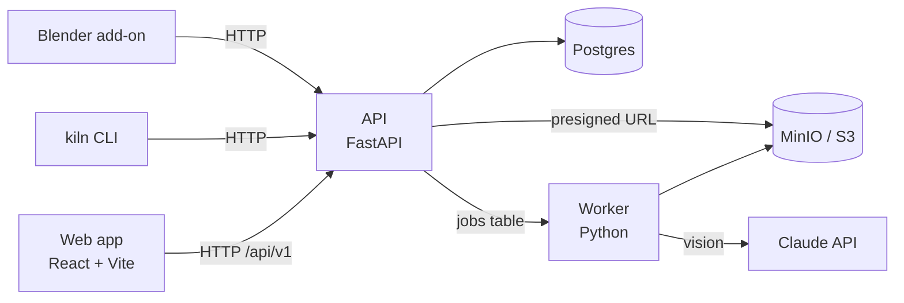

# Kiln

**Hub review và phát hành asset sáng tạo cho studio — upload, so sánh phiên bản, duyệt, có AI gắn tag và kiểm tra quy ước đặt tên; publish thẳng từ Blender.**

_Kiln is an AI-assisted asset review hub for creative studios: artists publish images, textures and 3D models from Blender or a CLI, leads review versions side by side, and Claude tags assets and flags naming-convention mistakes._

| Gallery               | Review                |
| --------------------- | --------------------- |
| _(ảnh chụp sau v0.1)_ | _(ảnh chụp sau v0.2)_ |

## Chạy nhanh

Cần: Python 3.12 + [uv](https://docs.astral.sh/uv/), Node ≥ 24, Docker.

```sh
make install   # npm workspaces + uv workspace
make up        # Postgres + MinIO
make api       # API trên :8000
make web       # web trên :5173
```

`make help` liệt kê mọi lệnh.

## Tính năng (theo release)

| Release | Nội dung                                                                                                 |
| ------- | -------------------------------------------------------------------------------------------------------- |
| v0.1    | Upload ảnh/`.glb`, gallery, chi tiết asset, worker tạo thumbnail                                         |
| v0.2    | Phiên bản, so sánh side-by-side, viewer 3D, ghi chú trên ảnh, comment, trạng thái duyệt                  |
| v0.3    | AI gắn tag + mô tả, lint quy ước đặt tên, tìm kiếm ngôn ngữ tự nhiên, add-on Blender, CLI `kiln publish` |
| v0.4    | Đánh bóng: nhất quán UI, a11y WCAG 2.2, Core Web Vitals, Storybook public, case study                    |

## Kiến trúc



Chi tiết: [docs/architecture](docs/architecture/README.md) · quyết định: [docs/adr](docs/adr) · quy ước: [docs/conventions.md](docs/conventions.md) · kiểm thử: [docs/testing.md](docs/testing.md) · bảo mật: [docs/security.md](docs/security.md) · design system: [docs/design-system.md](docs/design-system.md).

## Chất lượng

`make ci` = lint + typecheck + test + build cho mọi phần (ngưỡng trong `docs/testing.md`); GitHub Actions chạy y hệt. Commit theo Conventional Commits (scope trong `commitlint.config.mjs`), husky + commitlint chặn message sai. Mỗi tuần một release có CHANGELOG.

## Cấu trúc

```
apps/web/            React 19 + Vite + TanStack Router/Query
packages/ui/         design tokens, component, Storybook
packages/cli/        CLI Node `kiln`
services/api/        FastAPI + SQLAlchemy + Alembic
services/worker/     thumbnail, validate, AI tag
dcc/blender-addon/   add-on Blender "Publish to Kiln"
docs/                plan, ADR, kiến trúc, quy ước, kiểm thử
```

## Làm cùng AI

Dự án được phát triển với Claude Code: luật cho agent ở `CLAUDE.md`, mỗi turn kết thúc bằng một commit xanh. Phần AI trong sản phẩm được mô tả ở ADR 0002.

## Giấy phép và dữ liệu

Code: MIT. Asset mẫu trong `samples/` là tự làm hoặc CC0, ghi nguồn trong `samples/README.md`. Không commit asset của khách hàng.
