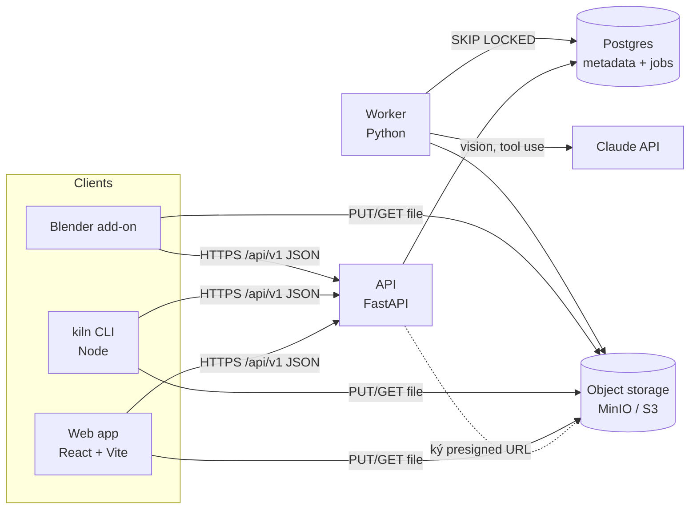

# Kiến trúc

## Luồng upload (v0.1)

1. Client `POST /api/v1/assets` (có `Idempotency-Key`) → API tạo `Asset` + `AssetVersion(pending_upload)`, trả presigned PUT URL (hết hạn 15 phút, giới hạn kiểu và kích thước).
2. Client PUT file lên storage, rồi `POST /api/v1/asset-versions/{id}/completions`.
3. API kiểm object tồn tại, chuyển `processing`, ghi job `thumbnail` (cùng transaction).
4. Worker lấy job, tạo thumbnail, (v0.3) gọi AI tag, chuyển `ready`. Web poll hoặc nghe SSE `/api/v1/events`.

## Bounded context

| Context  | Loại       | Thực thể chính                        |
| -------- | ---------- | ------------------------------------- |
| assets   | core       | Asset, AssetVersion, StoredFile       |
| review   | core       | Review, Annotation, Comment, Decision |
| catalog  | supporting | Tag, NamingRule, SearchPlan           |
| identity | generic    | User, Session, AccessToken (v0.2)     |

## Biên

| Biên            | Hợp đồng                                                                | Chủ    |
| --------------- | ----------------------------------------------------------------------- | ------ |
| clients → api   | OpenAPI (`services/api/openapi.json`, type TS sinh ra)                  | api    |
| api ↔ worker    | bảng `jobs` (`kind`, `payload` JSON có schema, `attempts`, `run_after`) | api    |
| worker → Claude | port `AiTagger`, schema tool trong `kiln_worker/ai/schemas.py`          | worker |
| web ↔ ui        | export của `@kiln/ui` (component + token CSS)                           | ui     |

## Xuyên suốt

- Cấu hình từ env `KILN_*`, kiểm khi khởi động (pydantic-settings); `.env.example` đủ khóa.
- Lỗi: RFC 9457 + `code`; web hiển thị theo `code`, không theo chuỗi.
- Quan sát: log JSON có `request_id`/`job_id`; `/health`, `/ready`; số liệu job (đang chờ, thất bại).
- Timeout: gọi storage 10 s, Claude 30 s; mọi vòng retry có backoff và giới hạn.

Cập nhật cùng mỗi ADR trong `docs/adr/`.
